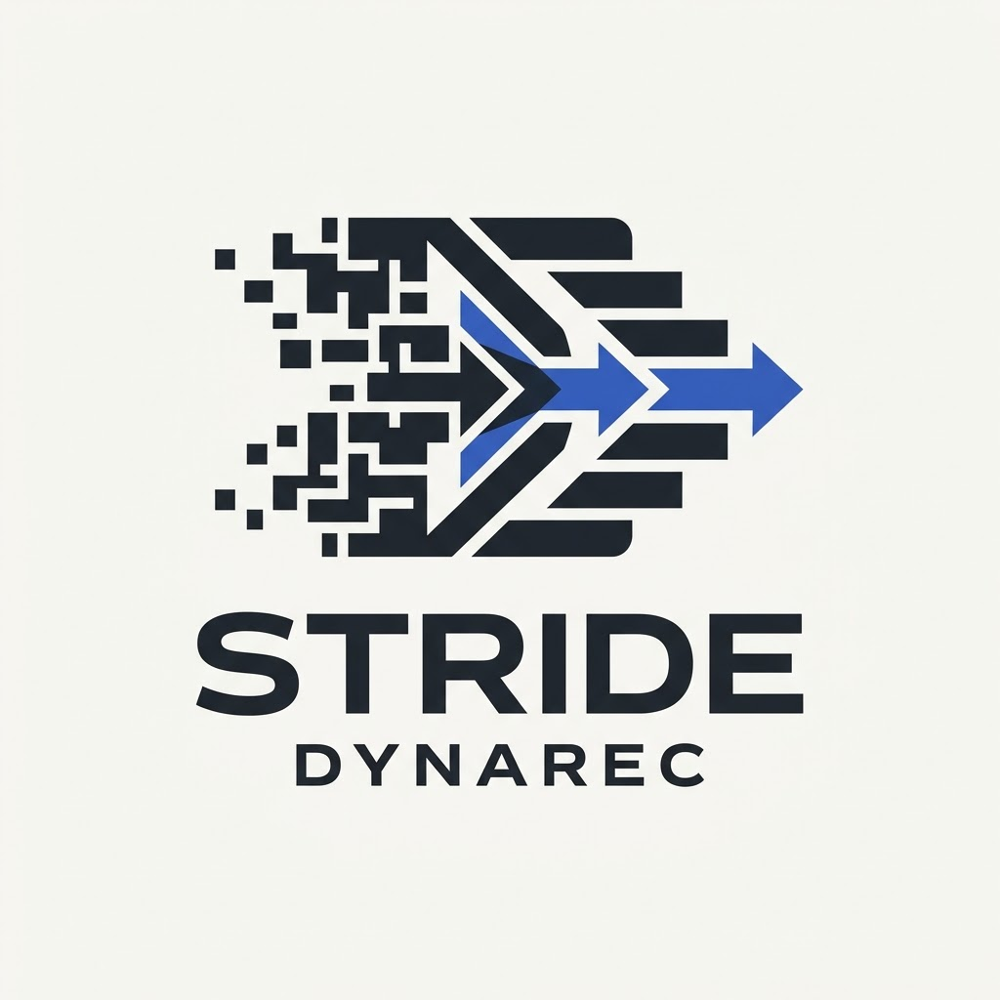

<p align="center">
  
</p>

# Stride Dynarec

Investigación aplicada sobre recompilación dinámica x86-64 → ARM64 en Android. Mide, comprende y —solo cuando la evidencia lo justifica— mejora el rendimiento, la estabilidad y el comportamiento térmico de la emulación x86-64 en ARM64.

No promete compatibilidad universal con juegos de PC. No promete rendimiento gráfico. No promete superar a Box64 ni a FEX. Produce mediciones reproducibles y, si los datos lo respaldan, contribuciones concretas a la pila existente.

## Estado

- **Fase:** B0 — primera ejecución funcional
- **Pin Box64:** `v0.4.4` (`2f130fab1d6e1a4ee8a71dc60cfdfcc839ad192a`)
- **Pin secundario:** `27860e6aee72dd33c2588d081652d6e9becc1089` (referencia, no base)
- **Dispositivo:** Samsung Galaxy S20 FE 5G (SD865, Android 13, Termux, sin root)

Ver `DEVICE_PROFILE.md` para el perfil completo.

## Estructura

```
stride-dynarec/
├── .github/workflows/
│   └── build-coremark-x86_64.yml     # Construye los dos binarios CoreMark
├── benchmarks/                       # Solo binarios verificados con hash
│   ├── coremark_x86_64
│   ├── coremark_x86_64.sha256
│   ├── coremark_x86_64_brief
│   ├── coremark_x86_64_brief.sha256
│   └── coremark_metadata.txt
├── scripts/
│   ├── bootstrap_box64.sh            # Clona Box64 en v0.4.4
│   ├── device_profile_probe.sh       # Captura el perfil del dispositivo
│   ├── h1_executor.sh                # Fase 1 + 3 + 4 de B0
│   └── lib_timing.sh                 # Helpers de reloj y sensores
├── results/
│   └── b0_<TS>/                      # Generado por h1_executor.sh
├── third_party/                      # Ignorado. Clonado por bootstrap.
├── DEVICE_PROFILE.md
└── README.md
```

## Reproducir B0

Requisitos en Termux: `pkg install -y git cmake make gcc binutils python`

```bash
git clone https://github.com/Hatblack2002/stride-dynarec.git
cd stride-dynarec

# 1. Obtener los binarios de CoreMark (workflow_dispatch)
#    Disparar el workflow desde GitHub Actions y descargar el artefacto
#    coremark-x86_64-binaries. Colocar los 5 archivos en benchmarks/.

# 2. Ejecutar B0
bash scripts/h1_executor.sh

# 3. Veredicto
cat results/b0_*/verdict.txt
```

## Reglas

- Ningún resultado se declara ejecutado sin log que lo demuestre.
- B1 y B2 bloqueadas hasta B0_OK.
- Wine, DXVK, Turnip, Mafia II, FEX, optimizaciones de dynarec y parches a Box64 están fuera de alcance en esta fase.
- No se mezclan variables en una comparación sin documentar.
- No se eliminan comprobaciones de seguridad ni se alteran semánticas de memoria sin análisis riguroso.
- Toda modificación se documenta y se asocia a un commit independiente.

## B0 — Criterios de aprobación

Siete condiciones obligatorias, todas deben cumplirse:

| # | Condición | Verificación |
|---|---|---|
| 1 | `v0.4.4` resuelto a hash de 40 hex | `git rev-parse v0.4.4` en el log |
| 2 | `box64` generado y ejecutable | `[ -x build/box64 ]` + `--version` |
| 3 | `coremark_x86_64` es ELF64 x86-64 | `readelf -h` muestra `Class: ELF64`, `Machine: Advanced Micro Devices X86-64` |
| 4 | `coremark_x86_64` no tiene `NEEDED` | `readelf -d` sin entradas NEEDED |
| 5 | SHA-256 coincide con el manifiesto | `sha256sum -c` retorna 0 |
| 6 | Ejecución termina con `exit_code==0` | Registrado en el log |
| 7 | Log contiene `Correct operation validated` | `grep` en `b0_run.log` |

Un fallo en cualquiera produce `B0_FAIL`. No hay aprobación parcial.

## Licencia

MIT. Ver `LICENSE`. Box64 (en `third_party/`) mantiene su licencia MIT original.
